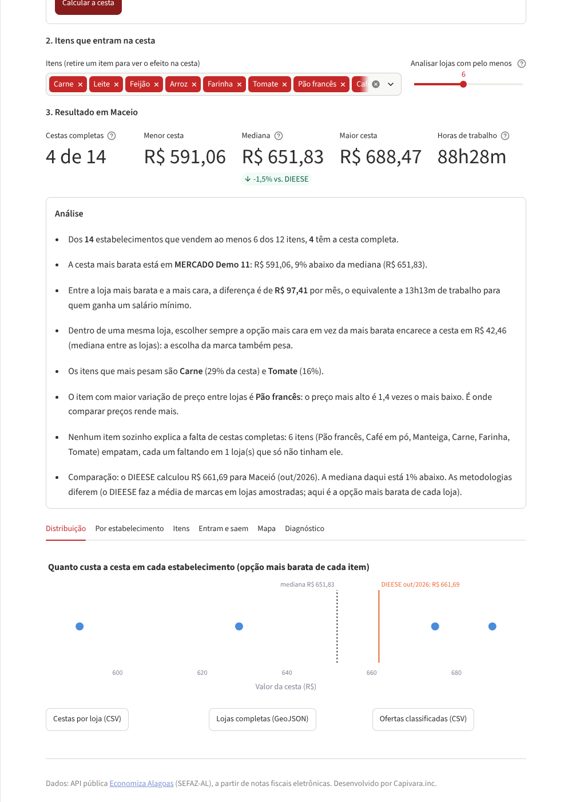
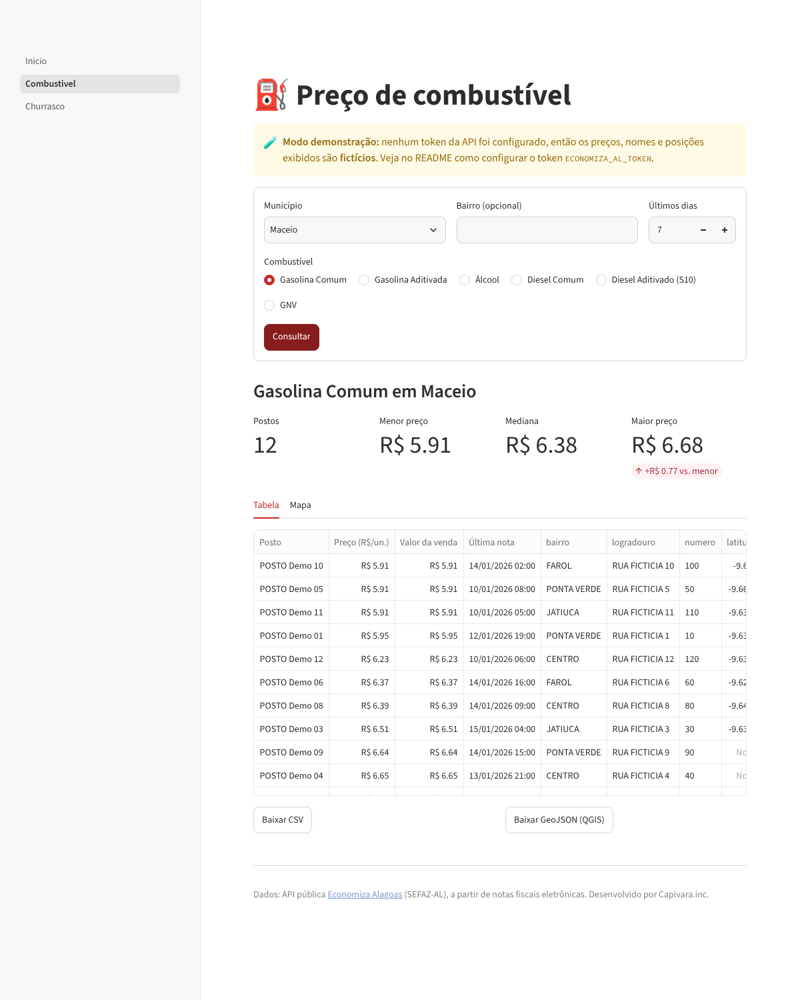
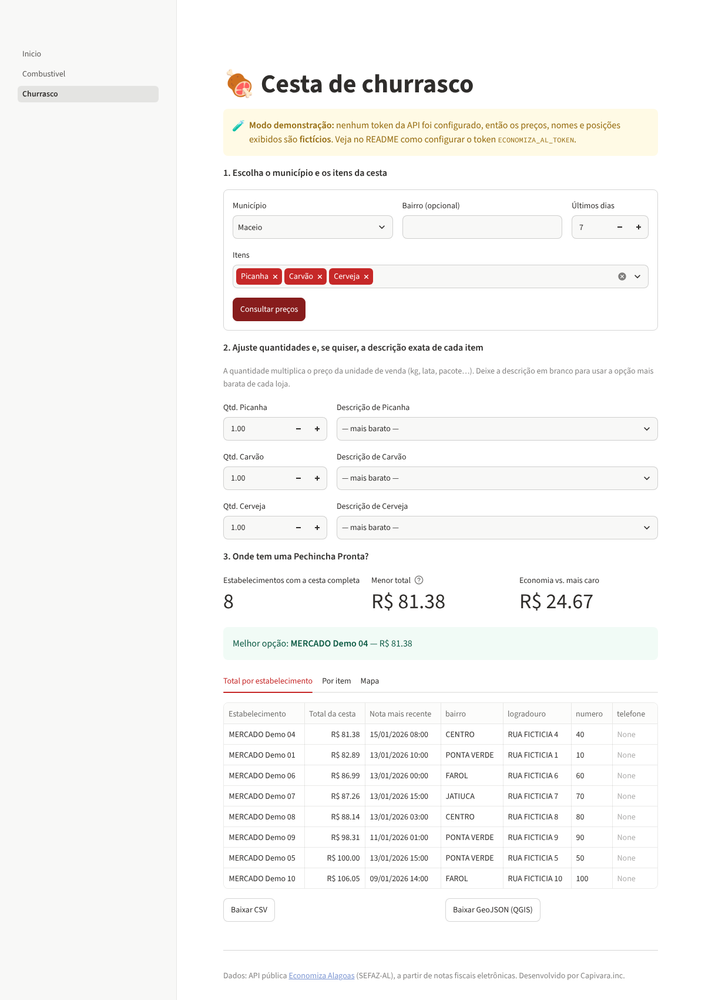

# Pechincha Pronta 🛒

[](https://github.com/juliourb/pechincha-pronta/actions/workflows/testes.yml)
[](https://github.com/juliourb/pechincha-pronta/actions/workflows/coleta.yml)


[](LICENSE)

Aplicativo em **Streamlit** que consulta a API pública **Economiza Alagoas** (SEFAZ-AL) para
descobrir **onde está mais barato** comprar em cada município alagoano, com base nas
**notas fiscais eletrônicas** emitidas pelos estabelecimentos.

- ⛽ **Combustível**: preço por posto, menor/mediana/maior preço do município e mapa.
- 🍖 **Cesta de churrasco**: monte a cesta e veja o estabelecimento com o **menor total**,
  entre os que vendem tudo. Os preços são comparados **por kg ou litro**, e cada item tem
  subfiltros (formato da cerveja, carne resfriada ou congelada, saco de carvão) e um
  **catálogo dos produtos encontrados** (nome, tamanho, em quantas lojas, menor preço) para
  escolher marcas específicas. Produtos com código de barras podem ser procurados também
  pelo GTIN, o que encontra lojas que os descrevem de outro jeito.
- 🧺 **Cesta básica**: a cesta do Decreto-Lei 399/1938 (a mesma do DIEESE) em cada
  estabelecimento, sem importar a marca. Mostra a menor e a maior cesta de cada loja,
  quais itens faltam, quais pesam mais e uma análise automática em texto. Em Maceió,
  compara com o valor oficial do DIEESE.
- 🗺️ **Panorama de Alagoas**: a cesta básica nos 102 municípios, com ranking, mapa
  coroplético, relação entre concorrência e preço e **série histórica**. Os dados vêm de uma
  coleta automática a cada 10 dias (GitHub Actions), guardada em Parquet. Detalhes em
  [docs/COLETA.md](docs/COLETA.md).
- 📥 **Exportação CSV e GeoJSON** (EPSG:4326), pronta para abrir no QGIS.
- 🧪 **Modo demonstração**: sem token, o app roda com dados **fictícios**, para que
  qualquer pessoa possa testar a interface.

App publicado: https://pechincha-pronta.streamlit.app

**Tecnologias:** Python · Streamlit · pandas · requests · folium (Leaflet) · plotly · pytest · GitHub Actions

| Cesta básica | Combustível | Cesta de churrasco |
|---|---|---|
|  |  |  |

<sub>Capturas feitas em modo demonstração: nomes, preços e posições são fictícios.</sub>

## Streamlit em 1 minuto

O app é feito com [Streamlit](https://streamlit.io), que transforma um script Python em
página web, sem HTML nem JavaScript. Quatro ideias explicam o código deste projeto:

| Conceito | Em poucas palavras | Onde aparece |
|---|---|---|
| **Reexecução** | a cada clique, o script roda inteiro de novo, de cima para baixo | todas as páginas |
| **`st.form`** | agrupa campos e só roda ao clicar no botão de envio | formulários de consulta |
| **`st.session_state`** | "memória" que sobrevive às reexecuções (por usuário) | resultados das consultas |
| **`st.cache_data`** | guarda o resultado de funções lentas, como chamadas à API | `economiza/ui.py` |

O passo a passo, com trechos reais do código, testes com `AppTest` e publicação no Streamlit
Community Cloud, está no **[Guia de Streamlit](docs/GUIA_STREAMLIT.md)**.

## Como funciona

```text
Streamlit (Inicio.py, pages/)
        │  escolhas do usuário
        ▼
economiza/ui.py ── cache de 15 min (st.cache_data)
        │
        ▼
economiza/api.py ── POST /combustivel/pesquisa e /produto/pesquisa
        │            (token no header AppToken, paginação, timeout, erros tratados)
        ▼
pandas DataFrame ── economiza/cesta.py (menor preço por item e loja, total da cesta)
                 └─ economiza/mapa.py  (mapa folium e GeoJSON)
```

**Regra da cesta** (`economiza/cesta.py`): para cada estabelecimento e item, fica o menor
preço (em empate, a nota mais recente). O subtotal é `preço × quantidade`, e só entram
estabelecimentos que têm **todos** os itens. Os itens são pesquisados pela descrição e pelos
códigos **NCM** (Nomenclatura Comum do Mercosul), conferidos na tabela NCM vigente
(`data/Tabela_NCM_Vigente_20240406.xlsx`).

## Cesta básica em resumo

1. Para cada um dos 12 itens da Região 2 (Alagoas), a API é consultada pelo **código NCM**,
   o que traz todas as marcas.
2. As ofertas são filtradas pela **especificação do DIEESE**: café em pó (não em grão), carne
   de primeira (patinho ou coxão), feijão carioca, farinha de mandioca etc.
3. O preço vira **R$ por kg, litro ou dúzia**, lendo o tamanho da embalagem na descrição.
4. Em cada loja: **menor cesta** (opção mais barata de cada item), **típica** (mediana) e
   **maior** (mais cara) = Σ quantidade do decreto × preço.
5. Indicadores do DIEESE: **horas de trabalho** e **% do salário mínimo líquido**.

A página permite **retirar itens** da cesta e ver o efeito, mostra **qual item mais impede**
a cesta completa e tem uma aba de **diagnóstico** com cada oferta aceita ou descartada.
Metodologia completa, fontes e limitações: **[docs/CESTA_BASICA.md](docs/CESTA_BASICA.md)**.

Para vários municípios ou o estado inteiro (gera CSV por município e GeoJSON para o QGIS):

```bash
python scripts/cesta_basica_estado.py --municipios MACEIO ARAPIRACA PENEDO
```

## Coleta automática e histórico

A cada 10 dias, o GitHub Actions calcula a cesta nos 102 municípios e publica os resultados
como uma Release (`coleta-AAAA-MM-DD`) em Parquet. A página Panorama lê esses arquivos e
abre sem consultar a API. Para ativar, cadastre o token como *secret* `ECONOMIZA_AL_TOKEN`
do repositório. Passo a passo, formato dos arquivos, consultas em SQL com DuckDB e projeção de
tamanho: [docs/COLETA.md](docs/COLETA.md).

## Rodando localmente

Requer Python 3.10 ou superior.

```bash
git clone https://github.com/juliourb/pechincha-pronta.git
```

```bash
cd pechincha-pronta
```

```bash
python -m venv .venv
```

```bash
source .venv/bin/activate   # no Windows: .venv\Scripts\activate
```

```bash
pip install -r requirements-dev.txt
```

```bash
streamlit run Inicio.py
```

Sem token, o app abre em **modo demonstração**. Para usar dados reais, veja abaixo.

### Token da API

O token é pessoal e gratuito: solicite à SEFAZ-AL pelo e-mail `api@sefaz.al.gov.br`,
conforme o [manual do desenvolvedor](https://economizaalagoas.sefaz.al.gov.br/desenvolvedor.htm).
Depois, configure-o de **uma** destas formas (nunca no código):

- arquivo `.streamlit/secrets.toml` (já está no `.gitignore`), a partir do exemplo:

  ```bash
  cp .streamlit/secrets.toml.example .streamlit/secrets.toml
  ```

- variável de ambiente:

  ```bash
  export ECONOMIZA_AL_TOKEN="seu-token"
  ```

- no **Streamlit Community Cloud**: *App settings → Secrets*, com a linha
  `ECONOMIZA_AL_TOKEN = "seu-token"` (passo a passo da publicação na seção 11 do
  [Guia de Streamlit](docs/GUIA_STREAMLIT.md#11-publicar-de-graça-no-streamlit-community-cloud)).

Se o endereço da API mudar, ele pode ser trocado sem alterar o código pela variável
`ECONOMIZA_AL_BASE_URL`.

## Erros comuns

| Mensagem no app | O que significa | O que fazer |
|---|---|---|
| Faixa amarela "Modo demonstração" | O token não foi encontrado | Configure `ECONOMIZA_AL_TOKEN` (veja acima) |
| "O token da API foi recusado" (HTTP 401/403) | Token inválido ou revogado | Peça um novo token à SEFAZ-AL |
| "O serviço da SEFAZ-AL está fora do ar…" (HTTP 500, `SHORTCIRCUIT`) | O *gateway* da SEFAZ cortou o acesso ao serviço, que está falhando ou sobrecarregado | Nada a corrigir no app: espere e tente mais tarde. O app já repete a consulta 2 vezes antes de desistir |
| "Não foi possível conectar…" | Sem resposta da API (rede ou tempo esgotado) | Tente mais tarde |

A API funciona por `http://`: na porta HTTPS, o servidor apresenta um certificado de outro
domínio, então não troque o endereço para `https://`.

## Testes

```bash
pytest -q
```

São 101 testes, todos sem acesso à rede: cliente da API com respostas simuladas (paginação,
erros HTTP, timeout), regras das cestas (incluindo as fórmulas do DIEESE conferidas com o
boletim de Maceió), leitura de embalagens, mapa/GeoJSON, o script estadual e testes de ponta a ponta das páginas com
`streamlit.testing` em modo demonstração. O GitHub Actions roda a suíte a cada push
(Python 3.10 e 3.12).

## Estrutura

```text
Inicio.py                 página inicial
pages/1_Combustivel.py    consulta de combustível
pages/2_Churrasco.py      cesta de churrasco
pages/3_Cesta_basica.py   cesta básica (Decreto-Lei 399/1938)
pages/4_Panorama.py       panorama estadual a partir das coletas guardadas
economiza/                lógica reutilizável (sem Streamlit, exceto ui.py)
  api.py                  cliente da API Economiza Alagoas
  cesta.py                NCMs da cesta de churrasco e cálculo do menor total
  cesta_basica.py         metodologia e análises da cesta básica (sem Streamlit)
  graficos.py             gráficos plotly da cesta básica e do panorama
  coleta.py               coleta estadual, Parquet, índice e leitura das Releases
  panorama.py             ranking, correlação e análise estadual
  mapa.py                 mapa folium e exportação GeoJSON
  municipios.py           102 municípios de AL e códigos IBGE
  demo.py                 dados fictícios para o modo demonstração
  ui.py                   componentes e cache compartilhados
scripts/                  coleta_estadual.py (Parquet, usado pelo Actions) e
                          cesta_basica_estado.py (CSV/GeoJSON para análise local)
tests/                    pytest
docs/                     guia de Streamlit, metodologia da cesta e capturas de tela
data/                     tabela NCM e dados auxiliares (SINESP) para estudos futuros
```

## Limitações

- Só aparecem estabelecimentos que emitiram nota fiscal no período consultado (até 10 dias).
- O preço é o da nota mais recente e pode diferir do preço atual no local.
- O mapa depende das coordenadas registradas na nota, que podem faltar ou ser imprecisas.
- O tamanho da embalagem é lido na descrição da nota. Ofertas sem tamanho (ex.: "DOSE
  CERVEJA") são descartadas e aparecem na aba **Diagnóstico** de cada cesta.
- Nas cestas, o subtotal é proporcional (kg ou litro × preço); na prática, compram-se
  embalagens inteiras.

## Histórico

| Versão | O que mudou |
|---|---|
| 2.4 | **Cesta do município** (mediana de cada item entre as lojas, como no DIEESE): o Panorama passa de 15 para 73 municípios, com mapa também por item. Consultas sem NCM e regras revistas com o manual da API e uma sondagem real. Churrasco com **catálogo de produtos** (tamanho, lojas, preço) e busca por **código de barras**. Tema escuro. Datas convertidas de UTC para o horário local. |
| 2.3 | Regras da cesta ajustadas com a 1ª coleta real (Maceió: R$ 660,27 vs. R$ 661,69 do DIEESE); reclassificação de coletas antigas; malha municipal guardada no repositório; mapas ignoram coordenadas fora de Alagoas e reenquadram ao abrir a aba. |
| 2.2 | Página **Panorama de Alagoas** e coleta automática a cada 10 dias (GitHub Actions + Parquet em Releases), com histórico, mapa coroplético e acompanhamento do tamanho dos dados. Nomes dos municípios com a grafia oficial. |
| 2.1 | Cesta de churrasco com preço por kg/litro, subfiltros por item e filtro por marca. Nova página **Cesta básica** (Decreto-Lei 399/1938, Região 2) com menor/típica/maior cesta por loja, cobertura e sensibilidade dos itens, análise automática, comparação com o DIEESE e script para o estado inteiro. |
| 2.0 | Publicado como repositório aberto. Código reorganizado no pacote `economiza/`; token fora do código; correções na cesta (NCMs duplicados, itens com o mesmo NCM misturados, paginação com filtro de bairro); tratamento de erros e timeout; cache; mapa sem chave de API; exportação CSV/GeoJSON; modo demonstração; testes e CI. |
| 1.5 (alpha) | Consultas de combustível e cesta de churrasco. |

## Contribuindo

Sugestões e correções são bem-vindas: abra uma *issue* ou um *pull request*. Antes de enviar,
rode `pytest -q`. Nunca inclua tokens no código ou nos commits.

## Licença e termos de uso

Código sob a [licença MIT](LICENSE). Os dados consultados são públicos e pertencem à SEFAZ-AL;
este é um aplicativo informativo, desenvolvido como estudo de Python sobre a API Economiza
Alagoas, sem garantia sobre a precisão dos dados.
